# Jarkom-Modul-3-2026-K-23

| Nama                | NRP        |
| ------------------- | ---------- | 
| Naoval James Osamah | 5027251092 |
| Rizki               | 5027251095 |

Prefix IP kelompok: **10.75**. Domain: **jujutsu.k23.com**.

## Ringkasan Node Infrastruktur

| Node    | Peran                       | Network | IP         | Gateway   |
| ------- | --------------------------- | ------- | ---------- | --------- |
| utahime | DNS Master                  | 1 (DMZ) | 10.75.1.2  | 10.75.1.1 |
| shoko   | DNS Slave                   | 1 (DMZ) | 10.75.1.3  | 10.75.1.1 |
| gojo    | Public Reverse Proxy        | 1 (DMZ) | 10.75.1.4  | 10.75.1.1 |
| geto    | Internal Load Balancer      | 4 (DC)  | 10.75.4.2  | 10.75.4.1 |
| maki    | Worker frontend             | 4 (DC)  | 10.75.4.3  | 10.75.4.1 |
| panda   | Worker frontend             | 4 (DC)  | 10.75.4.4  | 10.75.4.1 |
| nanami  | Worker API utama            | 4 (DC)  | 10.75.4.5  | 10.75.4.1 |
| todo    | Worker API utama            | 4 (DC)  | 10.75.4.6  | 10.75.4.1 |
| kirara  | Worker API cadangan         | 4 (DC)  | 10.75.4.7  | 10.75.4.1 |
| tengen  | DHCP Server                 | 4 (DC)  | 10.75.4.10 | 10.75.4.1 |
| yaga    | Database Master (MariaDB)   | 4 (DC)  | 10.75.4.11 | 10.75.4.1 |
| inumaki | Database Slave (MariaDB)    | 4 (DC)  | 10.75.4.12 | 10.75.4.1 |

Alur request dari klien:

```
klien ──► gojo (10.75.1.4) ──┬── /      ──► maki / panda          (web frontend)
                             └── /api   ──► geto (10.75.4.2) ──► nanami / todo (kirara backup)
                                                                      │
                                                                      ▼
                                                        yaga (master) ──► inumaki (slave)
```

## Persistensi Konfigurasi

Node Docker pada GNS3 kehilangan semua perubahan di luar `/root` dan
`/etc/network/interfaces` setiap kali direstart. Karena itu:

1. Seluruh instalasi dan konfigurasi ditulis sebagai skrip di `/root` dengan pola
   nama `/root/<node>-soalXX.sh`.
2. Baris di `/root/.bashrc` menjalankan ulang skrip terakhir node tersebut jika
   layanannya belum hidup.

| Node                 | Baris di `/root/.bashrc`                                           |
| -------------------- | ------------------------------------------------------------------ |
| semua node           | `echo "nameserver 192.168.122.1" > /etc/resolv.conf`               |
| jichi                | `pgrep dhcrelay >/dev/null \|\| bash /root/jichi-soal10.sh`        |
| tengen               | `pgrep dhcpd >/dev/null \|\| bash /root/tengen-soal10.sh`          |
| utahime              | `pgrep named >/dev/null \|\| bash /root/utahime-soal12.sh`         |
| shoko                | `pgrep named >/dev/null \|\| bash /root/shoko-soal12.sh`           |
| yaga                 | `pgrep mariadbd >/dev/null \|\| bash /root/yaga-soal13.sh`         |
| inumaki              | `pgrep mariadbd >/dev/null \|\| bash /root/inumaki-soal13.sh`      |
| maki, panda          | `pgrep nginx >/dev/null \|\| bash /root/<node>-soal14.sh`          |
| nanami, todo, kirara | `pgrep nginx >/dev/null \|\| bash /root/<node>-soal17.sh`          |
| geto                 | `pgrep nginx >/dev/null \|\| bash /root/geto-soal17.sh`            |
| gojo                 | `pgrep nginx >/dev/null \|\| bash /root/gojo-soal19.sh`            |

Baris `up echo ... > /etc/resolv.conf` pada editor _Edit network configuration_
GNS3 tidak tersimpan (baris yang mengandung `>` terbuang), sehingga resolver
dipasang lewat `.bashrc`.

## Soal 1 — Router jichi, NAT, dan IP Statis Infrastruktur

### Deskripsi

jichi mendapat WAN dari NAT pada eth0, sedangkan eth1–eth4 menjadi gateway
Network 1–4. IPv4 forwarding dan source NAT diaktifkan, lalu seluruh host
infrastruktur diberi IP statis sesuai tabel.

### Konfigurasi

GNS3: node _Stop_ → klik kanan → **Configure** → **Edit network configuration**.
Salinan konfigurasi tiap node ada di [`soal-1/script/`](soal-1/script/).

**jichi** — [soal-1/script/jichi/interfaces](soal-1/script/jichi/interfaces)

```
auto eth0
iface eth0 inet dhcp

auto eth1
iface eth1 inet static
    address 10.75.1.1
    netmask 255.255.255.0

auto eth2
iface eth2 inet static
    address 10.75.2.1
    netmask 255.255.255.0

auto eth3
iface eth3 inet static
    address 10.75.3.1
    netmask 255.255.255.0

auto eth4
iface eth4 inet static
    address 10.75.4.1
    netmask 255.255.255.0
```

Forwarding dan NAT — [soal-1/script/jichi/jichi-setup.sh](soal-1/script/jichi/jichi-setup.sh):

```bash
sysctl -w net.ipv4.ip_forward=1
iptables -t nat -C POSTROUTING -o eth0 -j MASQUERADE 2>/dev/null || iptables -t nat -A POSTROUTING -o eth0 -j MASQUERADE
iptables -P FORWARD ACCEPT
```

**Host infrastruktur** memakai format yang sama, contoh **tengen**
([soal-1/script/tengen/interfaces](soal-1/script/tengen/interfaces)):

```
auto eth0
iface eth0 inet static
    address 10.75.4.10
    netmask 255.255.255.0
    gateway 10.75.4.1
```

| Node    | Network | IP         | Gateway   |
| ------- | ------- | ---------- | --------- |
| utahime | 1       | 10.75.1.2  | 10.75.1.1 |
| shoko   | 1       | 10.75.1.3  | 10.75.1.1 |
| gojo    | 1       | 10.75.1.4  | 10.75.1.1 |
| geto    | 4       | 10.75.4.2  | 10.75.4.1 |
| maki    | 4       | 10.75.4.3  | 10.75.4.1 |
| panda   | 4       | 10.75.4.4  | 10.75.4.1 |
| nanami  | 4       | 10.75.4.5  | 10.75.4.1 |
| todo    | 4       | 10.75.4.6  | 10.75.4.1 |
| kirara  | 4       | 10.75.4.7  | 10.75.4.1 |
| tengen  | 4       | 10.75.4.10 | 10.75.4.1 |
| yaga    | 4       | 10.75.4.11 | 10.75.4.1 |
| inumaki | 4       | 10.75.4.12 | 10.75.4.1 |

**gojo** dan **todo** mendapat baris tambahan `hwaddress`:

```
# gojo
    hwaddress ether 02:42:0a:4b:01:04
# todo
    hwaddress ether 02:42:0a:4b:04:06
```

### Penjelasan

1. **`ip_forward=1`** mengizinkan jichi meneruskan paket antar-interface; tanpa ini
   jichi hanya memproses paket untuk dirinya sendiri.
2. **`MASQUERADE -o eth0`** mengganti IP sumber 10.75.x.x dengan IP eth0 jichi saat
   keluar ke internet, karena IP privat tidak dikenal di internet.
3. **`iptables -C ... ||`** mengecek dulu sebelum menambah aturan, sehingga
   MASQUERADE tidak dobel ketika script dijalankan ulang.
4. **Gateway** setiap host adalah IP jichi di network yang sama.
5. **`hwaddress`** ditambahkan karena gojo dan todo sempat mendapat MAC yang sama
   (`f2:dd:ec:51:c9:cb`) dari GNS3. Dua perangkat dengan MAC sama membuat tabel ARP
   berganti-ganti sehingga sebagian paket hilang.

### Pengujian

Skrip [soal-1/script/jichi/test-soal1.sh](soal-1/script/jichi/test-soal1.sh) di
jichi melakukan ping ke seluruh host infrastruktur dan ke internet. Host yang
memerlukan internet untuk instalasi paket menguji gateway dan `8.8.8.8`.

| Pengujian                              | Bukti                                         |
| -------------------------------------- | --------------------------------------------- |
| jichi → seluruh host dan internet      |    |
| jichi → gateway & internet             | 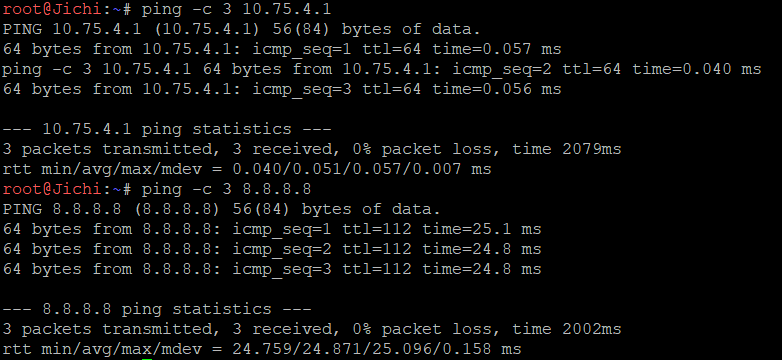         |
| tengen → gateway & internet            | 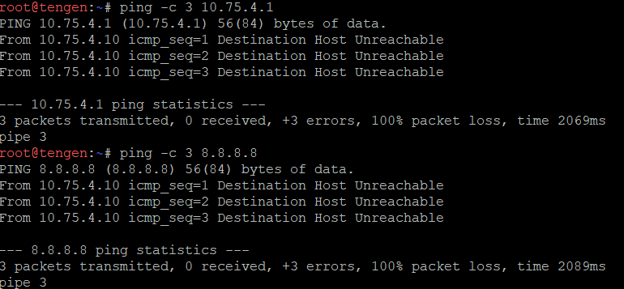       |
| yaga → gateway & internet              | 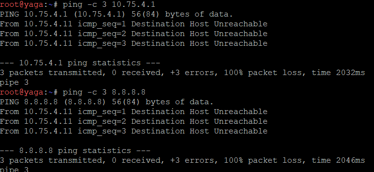           |
| inumaki → gateway & internet           | 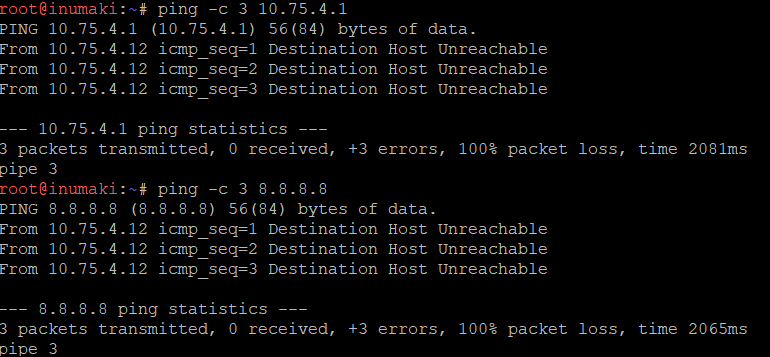     |

### Kesimpulan

jichi menjangkau seluruh host infrastruktur di Network 1 dan 4 serta internet,
dan host infrastruktur dapat menjangkau gateway masing-masing serta `8.8.8.8`
melalui NAT jichi.

## Soal 2 — DHCP Server tengen

### Deskripsi

Memasang `isc-dhcp-server` di tengen (10.75.4.10), mendeklarasikan Network 4
sebagai subnet lokal tanpa pool, dan menyiapkan scope untuk Network 2 dan 3.

### Konfigurasi

[soal-2/script/tengen/tengen-setup.sh](soal-2/script/tengen/tengen-setup.sh)
(dipakai juga oleh soal 4–6 dan dipanggil autostart soal 10):

```
# Subnet Network 4 (Lokal Data Center)
subnet 10.75.4.0 netmask 255.255.255.0 {
}

# Subnet Network 2 (Divisi A)
subnet 10.75.2.0 netmask 255.255.255.0 {
    option routers 10.75.2.1;
    option broadcast-address 10.75.2.255;
    ...
}

# Subnet Network 3 (Divisi B)
subnet 10.75.3.0 netmask 255.255.255.0 {
    option routers 10.75.3.1;
    option broadcast-address 10.75.3.255;
    ...
}
```

```bash
sed -i 's/^INTERFACESv4=.*/INTERFACESv4="eth0"/' /etc/default/isc-dhcp-server
/usr/sbin/dhcpd -t -q -cf /etc/dhcp/dhcpd.conf || { echo "dhcpd.conf ERROR, dhcpd tidak di-restart"; exit 1; }
/usr/sbin/dhcpd -4 -cf /etc/dhcp/dhcpd.conf eth0
```

### Penjelasan

1. **Subnet 10.75.4.0 kosong** wajib ada karena tengen sendiri berada di
   Network 4. dhcpd menolak berjalan dengan error *No subnet declaration* jika
   interface yang didengarkan tidak memiliki deklarasi subnet.
2. **Subnet 10.75.2.0 dan 10.75.3.0** tidak terhubung langsung ke tengen; request
   dari sana datang melalui relay jichi.
3. **`dhcpd -t`** memvalidasi config sebelum restart, sehingga config yang salah
   tidak mematikan layanan yang sedang berjalan.

### Pengujian

| Pengujian                        | Bukti                            |
| -------------------------------- | -------------------------------- |
| `dhcpd -t` dan status layanan    | 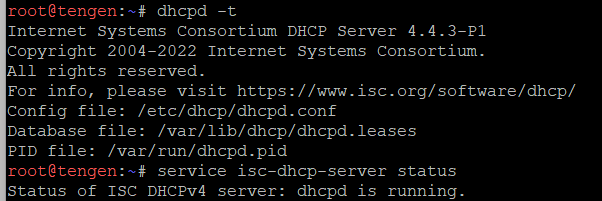  |

### Kesimpulan

`dhcpd -t` tidak menampilkan error dan layanan berstatus *dhcpd is running*.

## Soal 3 — DHCP Relay jichi

### Deskripsi

jichi meneruskan permintaan DHCP dari Network 2 (eth2) dan Network 3 (eth3) ke
tengen (10.75.4.10).

### Konfigurasi

[soal-3/script/jichi/jichi-setup.sh](soal-3/script/jichi/jichi-setup.sh):

```bash
which dhcrelay >/dev/null 2>&1 || { echo "nameserver 192.168.122.1" > /etc/resolv.conf && apt-get update && apt-get install -y isc-dhcp-relay; }
pkill dhcrelay 2>/dev/null
dhcrelay -i eth2 -i eth3 -i eth4 10.75.4.10
```

### Penjelasan

1. **DHCP memakai broadcast**, dan broadcast tidak menyeberang router. Relay
   menangkap broadcast di eth2/eth3 lalu meneruskannya sebagai unicast ke tengen.
2. **eth4 ikut didengarkan** karena balasan dari tengen datang melalui eth4.
3. Relay mengisi field **giaddr** dengan IP interface penerima (10.75.2.1 atau
   10.75.3.1), sehingga tengen tahu scope mana yang dipakai.

### Pengujian

| Pengujian                          | Bukti                               |
| ---------------------------------- | ----------------------------------- |
| Proses dhcrelay di jichi           | 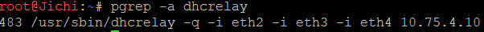   |
| itadori (Network 2) mendapat lease | 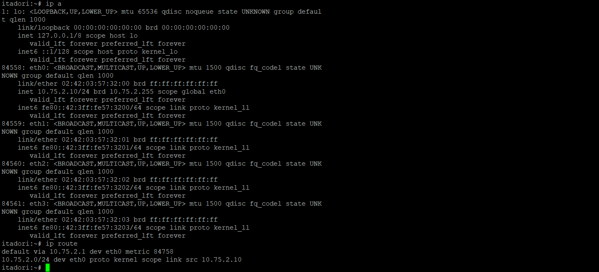 |
| ino (Network 3) mendapat lease     | 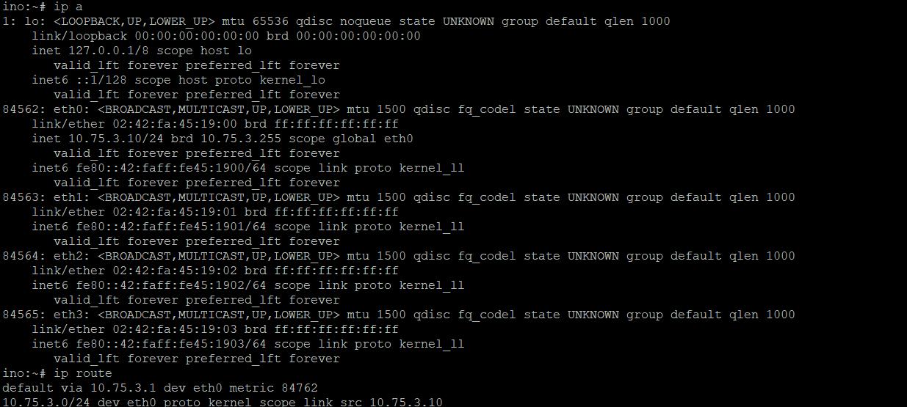     |

### Kesimpulan

itadori mendapat 10.75.2.10 dengan gateway 10.75.2.1, dan ino mendapat 10.75.3.10
dengan gateway 10.75.3.1, sehingga relay dari kedua subnet berjalan.

## Soal 4 — Pool 1 dan Pool 2 di Network 2

### Deskripsi

Pool 1 (10.75.2.10–.35) untuk itadori dan fushiguro, Pool 2 (10.75.2.70–.95) untuk
zenin dan okkotsu. Rentang .36–.69 tidak dialokasikan.

### Konfigurasi

```
class "pool1" { match hardware; }
subclass "pool1" 1:02:42:03:57:32:00; # MAC itadori
subclass "pool1" 1:02:42:18:a2:cc:00; # MAC fushiguro

class "pool2" { match hardware; }
subclass "pool2" 1:02:42:f9:90:c8:00; # MAC zenin
subclass "pool2" 1:02:42:ba:b5:0f:00; # MAC okkotsu

pool { allow members of "pool1"; range 10.75.2.10 10.75.2.35; }
pool { allow members of "pool2"; range 10.75.2.70 10.75.2.95; }
```

### Penjelasan

1. **`match hardware`** mengelompokkan client berdasarkan MAC. Awalan `1:` adalah
   kode tipe hardware Ethernet.
2. **`allow members of`** membuat setiap pool hanya melayani anggota kelasnya.
3. **Rentang .36–.69 tidak ditulis di pool mana pun**, sehingga tidak pernah
   dibagikan.
4. **MAC fushiguro dikoreksi** dari `f2:dd:ec:51:c9:cb` menjadi `02:42:18:a2:cc:00`.
   MAC `f2:dd:ec:51:c9:cb` ternyata MAC acak yang diberikan GNS3 setelah restart
   dan sempat muncul di gojo, todo, dan kusakabe, sehingga fushiguro tidak dilayani.

### Pengujian

| Client    | Pool   | Bukti                                       |
| --------- | ------ | ------------------------------------------- |
| itadori   | Pool 1 | 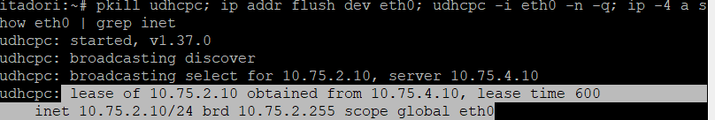   |
| fushiguro | Pool 1 |  |
| zenin     | Pool 2 | 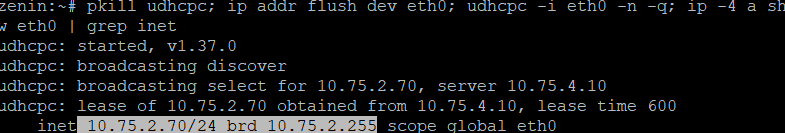       |
| okkotsu   | Pool 2 |    |

### Kesimpulan

itadori dan fushiguro mendapat alamat di 10.75.2.10–.35, sedangkan zenin dan okkotsu
di 10.75.2.70–.95, sesuai pembagian pool.

## Soal 5 — Short Lease, Long Lease, DNS, dan Domain Search

### Deskripsi

Di Network 3, ino dan kusakabe mendapat lease 1800 detik (10.75.3.10–.89), miwa
43200 detik (10.75.3.100–.199). Client juga menerima DNS 10.75.1.2 dan 10.75.1.3
serta domain-search `k23.com`.

### Konfigurasi

```
option domain-name "jujutsu.k23.com";
option domain-search "k23.com", "jujutsu.k23.com";
option domain-name-servers 10.75.1.2, 10.75.1.3;

if exists dhcp-parameter-request-list {
    option dhcp-parameter-request-list = concat(option dhcp-parameter-request-list, 77);
}

pool {
    allow members of "short_lease";
    default-lease-time 1800;
    max-lease-time 1800;
    range 10.75.3.10 10.75.3.89;
}
pool {
    allow members of "long_lease";
    default-lease-time 43200;
    max-lease-time 43200;
    range 10.75.3.100 10.75.3.199;
}
```

### Penjelasan

1. **`default-lease-time` dan `max-lease-time` disamakan** di setiap pool, sehingga
   client selalu menerima durasi yang ditentukan.
2. **Option 119 (domain-search) dipaksa dikirim.** ISC DHCP hanya mengirim option
   yang diminta client, sedangkan `udhcpc` tidak meminta option 119. Baris `concat
   (..., 77)` menambahkan 0x77 (119) ke daftar permintaan client.

### Pengujian

| Pengujian                                  | Bukti                                             |
| ------------------------------------------ | ------------------------------------------------- |
| ino: lease 1800, DNS                       | 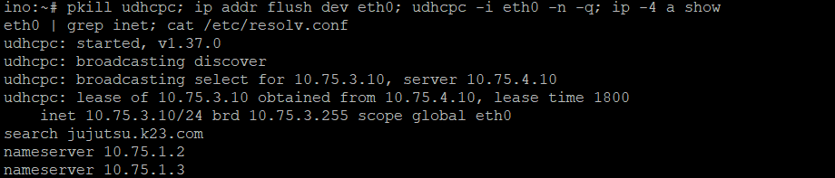                 |
| miwa: lease 43200                          | 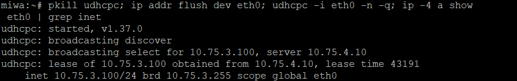               |
| Lease di tengen                            | 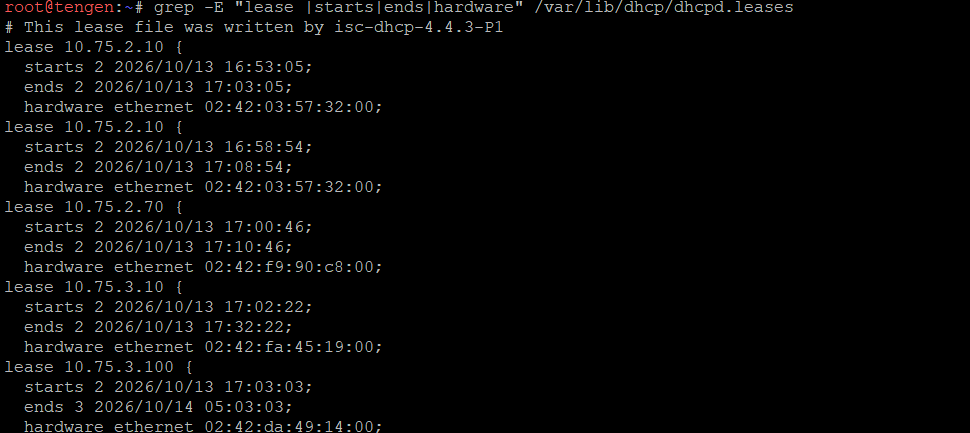            |
| Option domain-search diterima client       |     |

### Kesimpulan

ino dan miwa menerima durasi lease sesuai kelasnya, beserta DNS 10.75.1.2 dan
10.75.1.3 serta domain-search `k23.com`.

## Soal 6 — Fixed Address kugisaki

### Deskripsi

kugisaki selalu menerima 10.75.3.99 berdasarkan MAC address, di luar seluruh pool
dinamis.

### Konfigurasi

```
host kugisaki {
    hardware ethernet 02:42:97:95:f8:00;
    fixed-address 10.75.3.99;
    option routers 10.75.3.1;
}
```

### Penjelasan

1. **10.75.3.99 berada di luar** pool short lease (.10–.89) dan long lease
   (.100–.199), sehingga tidak mungkin diberikan ke client lain.
2. **Alamat fixed tidak dicatat di `dhcpd.leases`**, karena bukan lease dinamis yang
   dapat dipinjamkan ke client lain.

### Pengujian

| Pengujian                               | Bukti                              |
| --------------------------------------- | ---------------------------------- |
| Renew lease kugisaki                    | 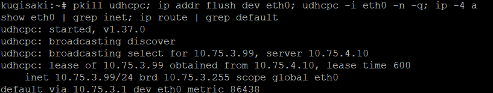 |
| Validasi config (`dhcpd -t`)            |     |

### Kesimpulan

Setelah lease diperbarui, kugisaki menerima 10.75.3.99 dengan gateway 10.75.3.1,
sesuai reservasi.

## Soal 7 — Verifikasi Konfigurasi Seluruh Client

### Deskripsi

Memeriksa IP, subnet mask, gateway, broadcast, DNS, dan domain-search seluruh
client Divisi A dan B, lalu mencocokkannya dengan `dhcpd.leases` di tengen.

### Pengujian

Di setiap client:

```bash
ip -4 addr show eth0 | grep inet
ip route
cat /etc/resolv.conf
```

Di tengen:

```bash
grep -E "^lease|hardware ethernet" /var/lib/dhcp/dhcpd.leases | paste - - | sort -u
```

| Client    | Bukti                                         |
| --------- | --------------------------------------------- |
| itadori   |             |
| fushiguro |           |
| zenin     |               |
| okkotsu   |             |
| ino       |                 |
| kusakabe  |            |
| miwa      |                |
| kugisaki  |            |
| Lease di tengen | 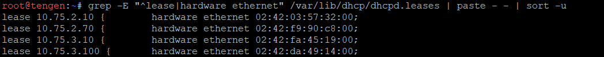              |

### Kesimpulan

Seluruh client menerima mask /24, broadcast, gateway, dan DNS yang sesuai dengan
network-nya. Setiap IP di `dhcpd.leases` sesuai dengan MAC dan pool pemiliknya,
tidak ada alamat ganda maupun alamat di luar kebijakan pool.

## Soal 8 — Packet Capture DORA

### Deskripsi

Menangkap urutan DHCPDISCOVER → DHCPOFFER → DHCPREQUEST → DHCPACK di tengen saat
client meminta lease baru, lalu mengidentifikasi server, alamat, lease time, dan
giaddr.

### Pengujian

Di tengen:

```bash
tcpdump -l -i eth0 -n -vvv port 67 or port 68 | grep -E "BOOTP|DHCP-Message|Gateway-IP|Your-IP|Server-ID|Lease-Time"
```

Di client (itadori):

```bash
pkill udhcpc; ip addr flush dev eth0; udhcpc -i eth0 -n -q
```

| Pengujian                     | Bukti                              |
| ----------------------------- | ---------------------------------- |
| Capture DORA di tengen        |      |

### Analisis

| Field        | Nilai          | Arti                                          |
| ------------ | -------------- | --------------------------------------------- |
| Server-ID    | 10.75.4.10     | tengen sebagai DHCP server                    |
| Your-IP      | 10.75.2.10     | alamat yang diberikan ke itadori              |
| Lease-Time   | 600            | lease default Pool 1                          |
| Gateway-IP (giaddr) | 10.75.2.1 | IP eth2 jichi, interface yang menerima request dari Network 2 |

Paket datang dari 10.75.4.1 (eth4 jichi) karena relay meneruskan request sebagai
unicast ke tengen, sedangkan giaddr tetap berisi IP interface asal request.

## Soal 9 — Gangguan dan Pemulihan Relay

### Deskripsi

Menghentikan DHCP relay di jichi, mengamati client yang gagal memperoleh lease,
lalu memulihkan relay dan membuktikan client kembali mendapat alamat dari pool
dan gateway semula.

### Pengujian

```bash
# jichi
pkill dhcrelay; pgrep -a dhcrelay

# itadori
pkill udhcpc; ip addr flush dev eth0; udhcpc -i eth0 -n -q

# jichi
bash /root/jichi-soal10.sh; pgrep -a dhcrelay

# itadori
udhcpc -i eth0 -n -q; ip route
```

| Pengujian                                | Bukti                                         |
| ---------------------------------------- | --------------------------------------------- |
| Relay dihentikan                         |      |
| itadori gagal mendapat lease             | 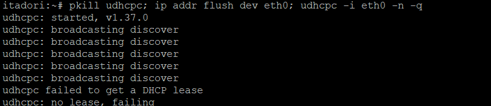             |
| Relay dipulihkan                         |    |
| itadori kembali mendapat lease           | 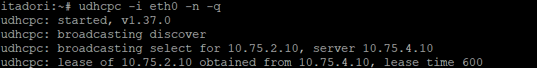             |

### Kesimpulan

Tanpa relay, broadcast DHCPDISCOVER itadori tidak pernah sampai ke tengen sehingga
`udhcpc` gagal setelah lima kali mencoba. Setelah relay dipulihkan, itadori kembali
menerima 10.75.2.10 dari Pool 1 dengan gateway 10.75.2.1.

## Soal 10 — Autostart DHCP Server dan DHCP Relay

### Deskripsi

Mengaktifkan autostart DHCP Server di tengen dan DHCP Relay di jichi, me-restart
kedua node, lalu memverifikasi status layanan, IP, gateway, lease, konektivitas
klien Network 2–3, serta kebijakan Pool 1, Pool 2, short lease, long lease, dan
fixed address.

### Masalah Awal

Konfigurasi sebelumnya gagal menyala otomatis karena:

1. Baris `post-up` ditulis **dua kali**, sehingga dua `apt-get` berjalan bersamaan
   dan saling berebut kunci dpkg.
2. Script langsung `apt-get install` saat boot **sebelum internet siap**; tengen
   bahkan bergantung pada NAT jichi yang juga baru menyala.
3. Proses latar belakang yang dijalankan `post-up ... &` ikut berhenti ketika
   `ifup` selesai, sehingga script terhenti di tengah.
4. Tidak ada log, dan error ditutup `2>/dev/null`.
5. `jichi-setup.sh` menambah aturan MASQUERADE tanpa cek, sehingga aturan menjadi
   dobel setiap kali dijalankan.
6. MAC fushiguro di Pool 1 salah (`f2:dd:ec:51:c9:cb`); MAC asli fushiguro
   `02:42:18:a2:cc:00`, sehingga fushiguro tidak mendapat IP.

### Konfigurasi

Container GNS3 tidak memiliki systemd dan kehilangan paket di luar `/root` setiap
restart, sehingga autostart dilakukan dengan dua jalur yang sama-sama memanggil
script soal 10:

- baris `post-up setsid -f ...` di network configuration (dijalankan saat interface
  menyala), dan
- baris di `/root/.bashrc` (shell console GNS3 dijalankan saat container menyala).

**jichi** — [soal-10/script/jichi/jichi-soal10.sh](soal-10/script/jichi/jichi-soal10.sh),
network configuration [soal-10/script/jichi/interfaces](soal-10/script/jichi/interfaces):

```
auto eth4
iface eth4 inet static
    address 10.75.4.1
    netmask 255.255.255.0
    post-up setsid -f bash /root/jichi-soal10.sh
```

**tengen** — [soal-10/script/tengen/tengen-soal10.sh](soal-10/script/tengen/tengen-soal10.sh),
network configuration [soal-10/script/tengen/interfaces](soal-10/script/tengen/interfaces):

```
auto eth0
iface eth0 inet static
    address 10.75.4.10
    netmask 255.255.255.0
    gateway 10.75.4.1
    post-up setsid -f bash /root/tengen-soal10.sh
```

Isi kebijakan DHCP tetap memakai [tengen-setup.sh](soal-10/script/tengen/tengen-setup.sh)
(bagian A) dengan perbaikan MAC fushiguro di Pool 1:

```
subclass "pool1" 1:02:42:18:a2:cc:00;
```

Inti script boot:

```bash
exec 9>/root/.jichi-soal10.lock
flock -n 9 || exit 0
exec >>/root/jichi-soal10.log 2>&1

iptables -t nat -C POSTROUTING -o eth0 -j MASQUERADE 2>/dev/null || iptables -t nat -A POSTROUTING -o eth0 -j MASQUERADE

for i in $(seq 1 90); do
    ping -c1 -W2 8.8.8.8 >/dev/null 2>&1 && getent hosts deb.debian.org >/dev/null && break
    sleep 2
done
```

### Penjelasan

1. **`flock`**: script mengunci file; jika `post-up` dan `.bashrc` memanggilnya
   bersamaan, panggilan kedua langsung keluar sehingga tidak ada dua instalasi
   berjalan bersamaan.
2. **Menunggu internet** (maksimal ±3 menit) sebelum `apt-get`, dan install dicoba
   sampai 3 kali.
3. **NAT jichi dipasang paling awal**, sebelum menunggu internet, agar tengen dapat
   segera menginstall paket melalui jichi.
4. **`iptables -C ... ||`** mengecek aturan dulu sehingga MASQUERADE tidak dobel.
5. **`setsid -f`** menjalankan script di sesi terpisah, sehingga tidak ikut berhenti
   ketika `ifup` selesai.
6. **`post-up` jichi diletakkan di blok eth4** agar seluruh interface (termasuk eth0
   yang mengambil internet) sudah menyala ketika script dijalankan.
7. **Log** di `/root/<node>-soal10.log` mencatat setiap boot dan diakhiri `AKTIF`
   atau `GAGAL`.

### Pengujian

tengen dan jichi di-restart tanpa membuka console, lalu klien meminta IP.

| Pengujian                                   | Bukti                                                      |
| ------------------------------------------- | ---------------------------------------------------------- |
| itadori mendapat IP setelah restart         | 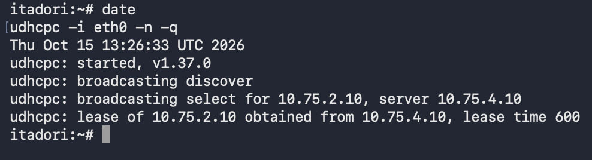  |
| Status tengen (post-up, dhcpd, log)         | 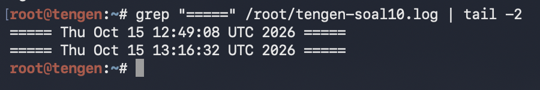         |
| Status jichi (post-up, dhcrelay, NAT, log)  | 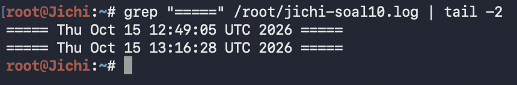           |
| Waktu boot di log tengen                    |       |
| Waktu boot di log jichi                     |         |
| Lease di tengen                             | 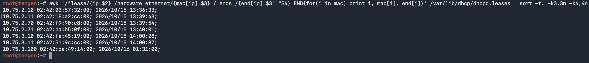                 |

Waktu boot dan permintaan IP:

```
jichi  : ===== Thu Oct 15 13:16:28 UTC 2026 =====  ... DHCP RELAY AKTIF
tengen : ===== Thu Oct 15 13:16:32 UTC 2026 =====  ... DHCP SERVER AKTIF
itadori: Thu Oct 15 13:26:33 UTC 2026
         lease of 10.75.2.10 obtained from 10.75.4.10, lease time 600
```

Lease di tengen setelah restart:

```
10.75.2.10  02:42:03:57:32:00  2026/10/15 13:36:33   itadori    (Pool 1, 600 s)
10.75.2.11  02:42:18:a2:cc:00  2026/10/15 13:39:43   fushiguro  (Pool 1, 600 s)
10.75.2.70  02:42:f9:90:c8:00  2026/10/15 13:39:54   zenin      (Pool 2, 600 s)
10.75.2.71  02:42:ba:b5:0f:00  2026/10/15 13:40:01   okkotsu    (Pool 2, 600 s)
10.75.3.10  02:42:fa:45:19:00  2026/10/15 14:00:28   ino        (short, 1800 s)
10.75.3.11  02:42:51:9c:cc:00  2026/10/15 14:00:37   kusakabe   (short, 1800 s)
10.75.3.100 02:42:da:49:14:00  2026/10/16 01:31:00   miwa       (long, 43200 s)
```

Hasil per klien:

| Klien     | Kebijakan     | IP          | Lease | Gateway   | Ping google.com | Bukti |
| --------- | ------------- | ----------- | ----- | --------- | --------------- | ----- |
| itadori   | Pool 1        | 10.75.2.10  | 600   | 10.75.2.1 | 0% loss | 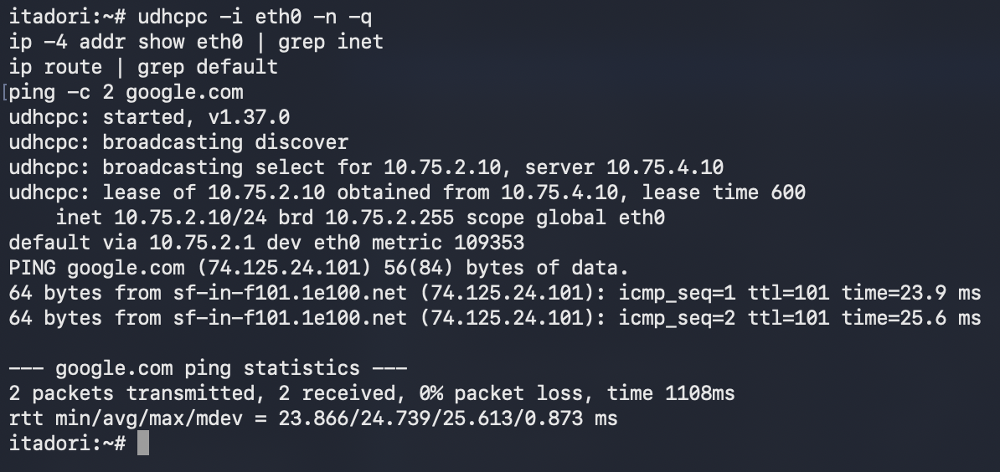 |
| fushiguro | Pool 1        | 10.75.2.11  | 600   | 10.75.2.1 | 0% loss | 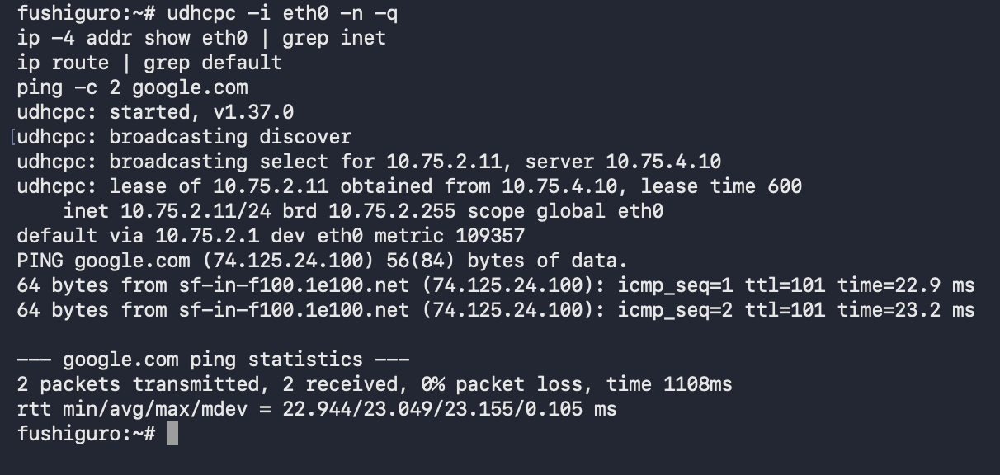 |
| zenin     | Pool 2        | 10.75.2.70  | 600*  | 10.75.2.1 | 0% loss | 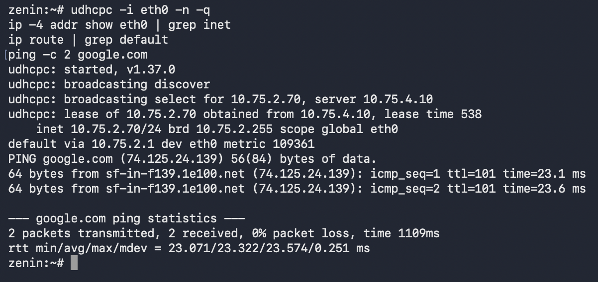 |
| okkotsu   | Pool 2        | 10.75.2.71  | 600   | 10.75.2.1 | 0% loss | 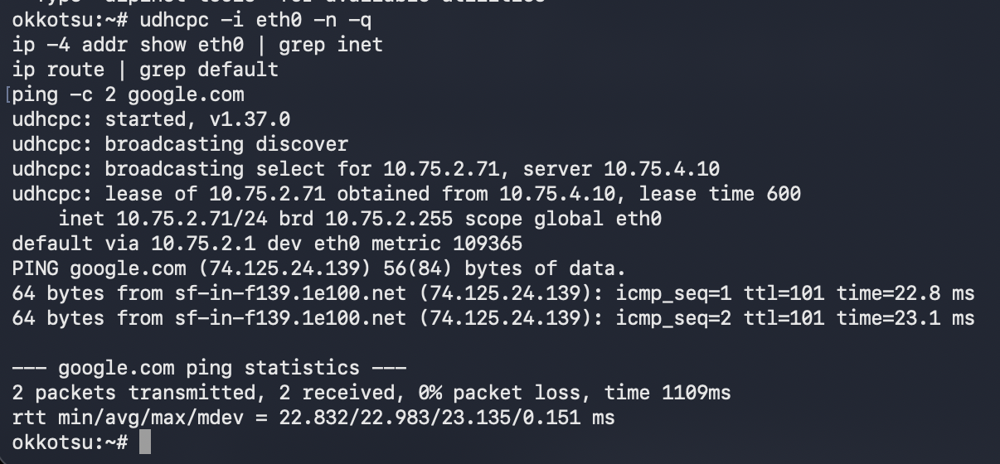 |
| ino       | Short lease   | 10.75.3.10  | 1800  | 10.75.3.1 | 0% loss | 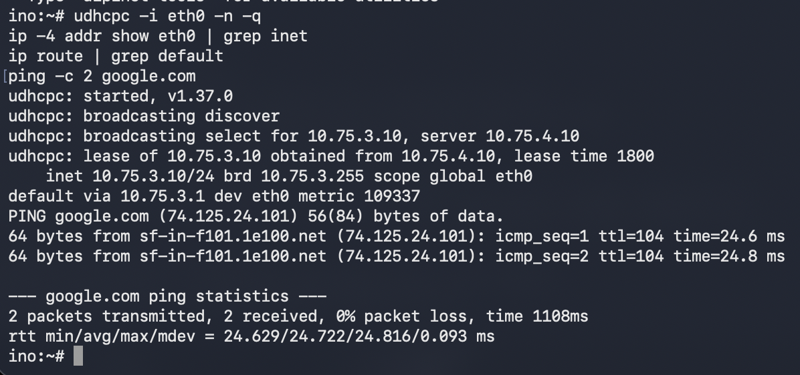 |
| kusakabe  | Short lease   | 10.75.3.11  | 1800  | 10.75.3.1 | 0% loss | 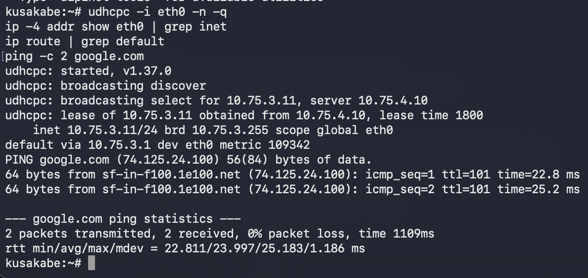 |
| miwa      | Long lease    | 10.75.3.100 | 43200 | 10.75.3.1 | 0% loss | 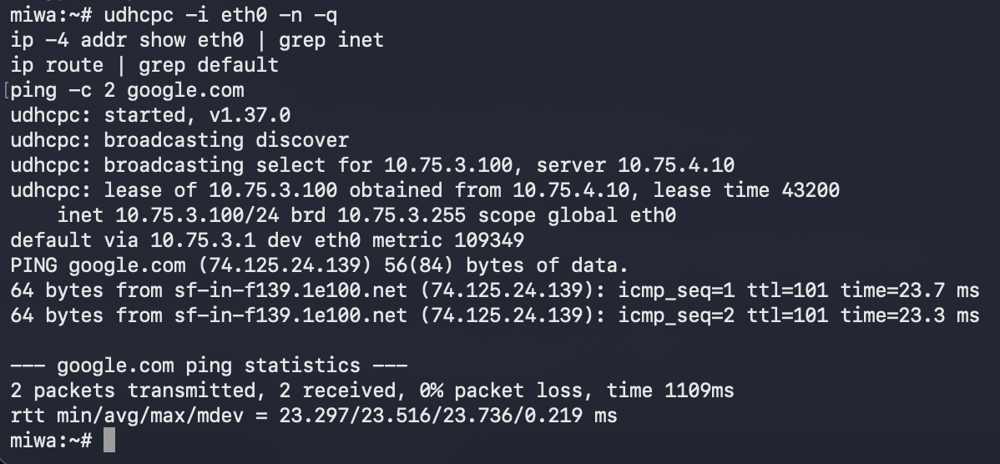 |
| kugisaki  | Fixed address | 10.75.3.99  | 600   | 10.75.3.1 | 0% loss | 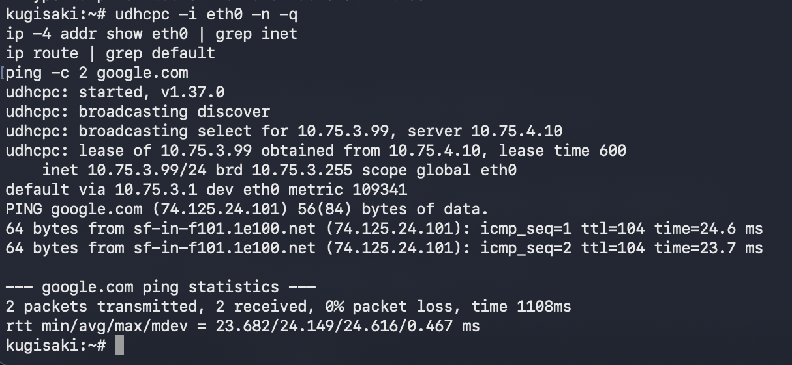 |

\* zenin menerima `lease time 538` karena masih memegang lease yang baru berjalan
±62 detik. ISC DHCP melanjutkan lease yang sama dan memberitahukan sisa waktunya
(600 − 62 = 538) alih-alih membuat lease baru.

### Kesimpulan

Log tengen dan jichi menunjukkan kedua layanan menyala sendiri saat boot
(13:16:28 dan 13:16:32) dan berakhir `AKTIF`, tanpa console dibuka. Sepuluh
menit kemudian itadori mendapat IP dari tengen melalui relay jichi. Waktu
berakhirnya lease cocok dengan kebijakan masing-masing: itadori meminta IP pada
13:26:33 dan lease-nya berakhir 13:36:33 (600 detik), ino dan kusakabe berakhir
30 menit setelah permintaan (1800 detik), dan miwa 12 jam setelahnya (43200
detik). kugisaki tidak tercatat di file lease karena alamat tetap (`host ...
fixed-address`) tidak dikelola sebagai lease dinamis, tetapi kugisaki tetap
menerima 10.75.3.99. Seluruh klien Network 2 dan 3 mendapat gateway yang benar
dan dapat menjangkau internet.

## Soal 11 — DNS Master (utahime) dan Slave (shoko)

### Deskripsi

Membangun zona `jujutsu.k23.com` di utahime (master) dan menyalinnya ke shoko
(slave) dengan SOA, NS untuk kedua server, `allow-transfer`, serta sinkronisasi
otomatis ketika serial dinaikkan.

### Konfigurasi

**utahime** — [soal-11/script/utahime/utahime-soal11.sh](soal-11/script/utahime/utahime-soal11.sh)

`named.conf.local`:

```
zone "jujutsu.k23.com" {
    type master;
    notify yes;
    also-notify { 10.75.1.3; };
    allow-transfer { 10.75.1.3; };
    file "/etc/bind/jarkom/jujutsu.k23.com";
};
```

Zone file `/etc/bind/jarkom/jujutsu.k23.com`:

```
$TTL    604800
@       IN      SOA     ns1.jujutsu.k23.com. root.jujutsu.k23.com. (
                        2026101401 ; Serial (YYYYMMDDXX)
                        604800     ; Refresh
                        86400      ; Retry
                        2419200    ; Expire
                        604800 )   ; Negative Cache TTL
;
@       IN      NS      ns1.jujutsu.k23.com.
@       IN      NS      ns2.jujutsu.k23.com.
ns1     IN      A       10.75.1.2
ns2     IN      A       10.75.1.3
```

**shoko** — [soal-11/script/shoko/shoko-soal11.sh](soal-11/script/shoko/shoko-soal11.sh)

```
zone "jujutsu.k23.com" {
    type slave;
    masters { 10.75.1.2; };
    file "/var/lib/bind/jujutsu.k23.com";
};
```

**Uji sinkronisasi** — [soal-11/script/utahime/utahime-soal11-sync.sh](soal-11/script/utahime/utahime-soal11-sync.sh)
menaikkan serial `2026101401` → `2026101402`, mengecek zona, lalu `rndc reload jujutsu.k23.com`.

### Penjelasan

1. **SOA** menetapkan ns1 (utahime) sebagai pemilik resmi zona; **NS** mendaftarkan
   ns1 dan ns2 (shoko) sebagai server yang berwenang menjawab.
2. **`notify yes` + `also-notify`** membuat utahime langsung memberi tahu shoko
   setiap kali zona berubah. **`allow-transfer`** membatasi penyalinan zona hanya
   untuk shoko.
3. **Serial format YYYYMMDDXX.** shoko hanya menyalin ulang zona jika serial di
   master lebih besar dari salinannya.
4. **Zona slave disimpan di `/var/lib/bind/`** karena BIND berjalan sebagai user
   `bind` yang tidak boleh menulis di `/etc/bind/`.

### Pengujian

Dari klien, `dig` ke kedua server, lalu serial dinaikkan dan dicek ulang di shoko.

| Pengujian                          | Bukti                                                 |
| ---------------------------------- | ----------------------------------------------------- |
| Query ke utahime                   |  |
| Query ke shoko                     |      |
| Serial naik, shoko ikut tersinkron |         |

### Kesimpulan

utahime dan shoko sama-sama menjawab zona `jujutsu.k23.com` secara authoritative.
Setelah serial dinaikkan di utahime, serial di shoko ikut berubah tanpa
konfigurasi ulang di shoko, membuktikan zone transfer otomatis berjalan.

## Soal 12 — A Record, CNAME, PTR, dan Forwarder

### Deskripsi

Mengarahkan `jujutsu.k23.com` ke gojo, membuat CNAME `www`, reverse DNS (PTR) untuk
IP gojo, dan forwarder ke `192.168.122.1`.

### Konfigurasi

**utahime** — [soal-12/script/utahime/utahime-soal12.sh](soal-12/script/utahime/utahime-soal12.sh)

`named.conf.options`:

```
options {
    directory "/var/cache/bind";
    forwarders { 192.168.122.1; };
    dnssec-validation no;
    allow-query { any; };
    allow-recursion { any; };
    listen-on-v6 { any; };
};
```

Record baru di zona `jujutsu.k23.com` (serial `2026101501`):

```
@       IN  A     10.75.1.4
www     IN  CNAME jujutsu.k23.com.
```

Zona reverse `1.75.10.in-addr.arpa`:

```
@       IN  NS  ns1.jujutsu.k23.com.
@       IN  NS  ns2.jujutsu.k23.com.
4       IN  PTR jujutsu.k23.com.
```

**shoko** — [soal-12/script/shoko/shoko-soal12.sh](soal-12/script/shoko/shoko-soal12.sh)
menjadi slave untuk kedua zona.

### Penjelasan

1. **A record apex** (`@`) mengarahkan `jujutsu.k23.com` ke gojo, pintu masuk utama.
2. **CNAME `www`** adalah alias ke nama `jujutsu.k23.com.`, bukan ke IP, sehingga jika
   IP gojo berubah, `www` ikut menyesuaikan.
3. **Zona `1.75.10.in-addr.arpa`**: IP ditulis terbalik karena DNS membaca dari
   bagian paling umum. Angka `4` adalah oktet terakhir IP gojo (10.75.1.**4**).
4. **`forwarders`** meneruskan pertanyaan di luar zona (misalnya `google.com`) ke DNS
   NAT. **`dnssec-validation no`** agar jawaban forwarder tidak ditolak.
5. **`allow-recursion { any; }`**: klien berada di network lain (10.75.2.x, 10.75.3.x).
   Tanpa ini, BIND menolak mencarikan domain luar untuk klien di luar jaringannya.

### Pengujian

| Pengujian                   | Bukti                                            |
| --------------------------- | ------------------------------------------------ |
| `dig www.jujutsu.k23.com`   |     |
| `dig -x 10.75.1.4`          |         |
| `ping google.com` dari klien |    |

### Kesimpulan

`www.jujutsu.k23.com` dijawab sebagai CNAME ke `jujutsu.k23.com` → 10.75.1.4,
`10.75.1.4` di-reverse menjadi `jujutsu.k23.com`, dan klien tetap dapat menjangkau
`google.com` melalui forwarder.

## Soal 13 — Database Master (yaga) dan Slave (inumaki)

### Deskripsi

MariaDB di yaga sebagai master dan inumaki sebagai slave. Membuat database
`db_shibuya_k23` dan tabel `request_logs`, mengaktifkan binary log, menghubungkan
slave dengan `CHANGE MASTER TO`, memberi akses remote untuk Network 4, lalu
membuktikan replikasi.

### Konfigurasi

**yaga (master)** — [soal-13/script/yaga/yaga-soal13.sh](soal-13/script/yaga/yaga-soal13.sh)

```
[mysqld]
bind-address  = 0.0.0.0
server-id     = 1
log-bin       = mysql-bin
binlog_format = ROW
```

```sql
CREATE DATABASE IF NOT EXISTS db_shibuya_k23;
CREATE USER IF NOT EXISTS 'k23'@'10.75.4.%' IDENTIFIED BY 'k23pass';
GRANT ALL PRIVILEGES ON db_shibuya_k23.* TO 'k23'@'10.75.4.%';
CREATE USER IF NOT EXISTS 'repl'@'10.75.4.12' IDENTIFIED BY 'replpass';
GRANT REPLICATION SLAVE, REPLICATION CLIENT ON *.* TO 'repl'@'10.75.4.12';

CREATE TABLE IF NOT EXISTS request_logs (
    id INT AUTO_INCREMENT PRIMARY KEY,
    worker_name VARCHAR(50) NOT NULL,
    client_ip VARCHAR(50) NOT NULL,
    proxy_ip VARCHAR(50) NOT NULL,
    user_agent TEXT,
    created_at TIMESTAMP DEFAULT CURRENT_TIMESTAMP
);
```

**inumaki (slave)** — [soal-13/script/inumaki/inumaki-soal13.sh](soal-13/script/inumaki/inumaki-soal13.sh)

```
[mysqld]
bind-address = 0.0.0.0
server-id    = 2
relay-log    = relay-bin
read_only    = 1
```

```sql
CHANGE MASTER TO
    MASTER_HOST='10.75.4.11', MASTER_USER='repl', MASTER_PASSWORD='replpass',
    MASTER_PORT=3306, MASTER_LOG_FILE='mysql-bin.000001', MASTER_LOG_POS=4,
    MASTER_USE_GTID=no, MASTER_CONNECT_RETRY=10;
START SLAVE;
```

### Penjelasan

1. **Binary log** adalah catatan setiap perubahan data di master. Slave membaca
   catatan ini lalu mengulang perubahan yang sama, sehingga isinya selalu ikut.
2. **`server-id`** harus unik (yaga 1, inumaki 2) agar setiap server dalam
   replikasi dapat dibedakan.
3. **`bind-address = 0.0.0.0`**: bawaan MariaDB hanya menerima koneksi dari dirinya
   sendiri (127.0.0.1), sehingga worker dan inumaki tidak dapat terhubung.
4. **`'k23'@'10.75.4.%'`**: tanda `%` mencakup seluruh IP Network 4, sesuai
   permintaan akses remote untuk seluruh node di Network 4.
5. **User `repl` khusus replikasi**, hanya boleh dari 10.75.4.12, terpisah dari user
   aplikasi.
6. **`MASTER_LOG_POS=4` pada binlog pertama**: inumaki membaca binlog dari awal,
   sehingga `CREATE DATABASE` dan `CREATE TABLE` ikut tersalin tanpa dibuat manual.
   Posisi 4 adalah awal isi binlog (4 byte pertama adalah penanda format).
7. **`read_only = 1`**: slave tidak boleh ditulis langsung; thread replikasi tetap
   dapat menulis.
8. Skrip inumaki **menunggu yaga siap** dan hanya menjalankan `CHANGE MASTER TO`
   jika replikasi belum pernah dikonfigurasi, agar aman dijalankan ulang.

### Pengujian

| Pengujian                                          | Bukti                                                        |
| -------------------------------------------------- | ------------------------------------------------------------ |
| Binlog aktif di yaga                               | 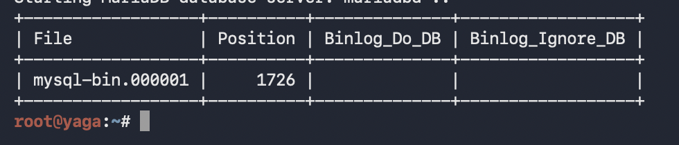           |
| Status slave di inumaki                            | 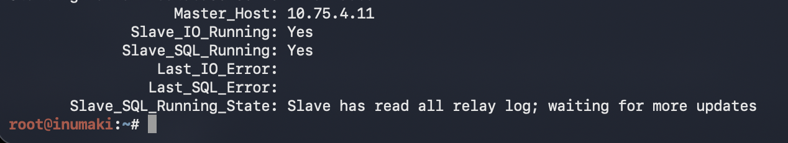             |
| INSERT di yaga                                     | 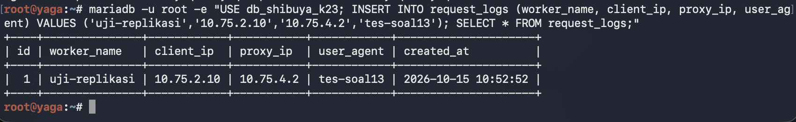           |
| SELECT di inumaki                                  | 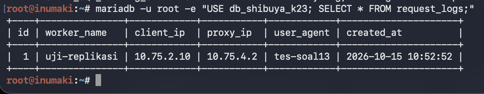            |
| Worker Network 4 menulis ke yaga                   | 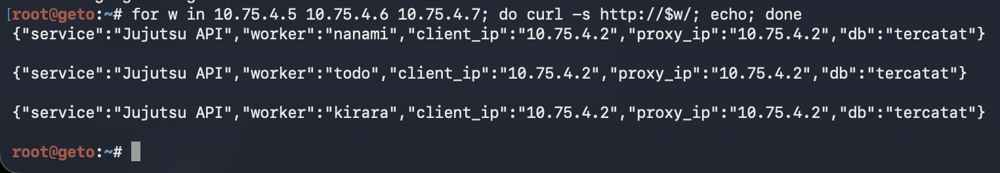           |
| Data dari worker tersalin ke inumaki               | 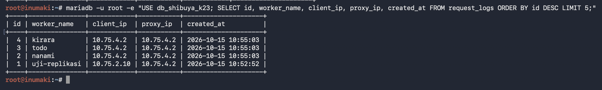         |

Status master dan slave:

```
| File             | Position |
| mysql-bin.000001 |     1726 |

Master_Host: 10.75.4.11
Slave_IO_Running: Yes
Slave_SQL_Running: Yes
Slave_SQL_Running_State: Slave has read all relay log; waiting for more updates
```

Data di inumaki setelah INSERT di yaga dan request dari ketiga worker:

```
| id | worker_name   | client_ip  | proxy_ip  | created_at          |
|  4 | kirara        | 10.75.4.2  | 10.75.4.2 | 2026-10-15 10:55:03 |
|  3 | todo          | 10.75.4.2  | 10.75.4.2 | 2026-10-15 10:55:03 |
|  2 | nanami        | 10.75.4.2  | 10.75.4.2 | 2026-10-15 10:55:03 |
|  1 | uji-replikasi | 10.75.2.10 | 10.75.4.2 | 2026-10-15 10:52:52 |
```

### Kesimpulan

`Slave_IO_Running` dan `Slave_SQL_Running` bernilai `Yes`. Baris `uji-replikasi`
hanya dimasukkan di yaga, tetapi muncul di inumaki dengan `created_at` yang sama,
membuktikan replikasi berjalan. Baris id 2–4 ditulis oleh nanami, todo, dan kirara
dari Network 4 (`"db":"tercatat"`), membuktikan akses remote berhasil sekaligus
ikut tersalin ke slave.

## Soal 14 — Worker Frontend dan Worker API

### Deskripsi

Memasang Nginx + PHP-FPM pada maki dan panda (web frontend yang menampilkan
hostname) serta pada nanami, todo, dan kirara (API yang mencatat log ke yaga).
Akses langsung dari klien ke worker ditolak: worker web hanya menerima trafik dari
gojo, worker API hanya dari geto.

### Konfigurasi

**maki & panda** — [soal-14/script/maki/maki-soal14.sh](soal-14/script/maki/maki-soal14.sh)
(panda identik)

```
server {
    listen 80 default_server;
    server_name jujutsu.k23.com www.jujutsu.k23.com;
    root /var/www/frontend;
    index index.php;

    allow 10.75.1.4;     # gojo
    allow 127.0.0.1;
    deny all;
    ...
}
```

**nanami, todo & kirara** — [soal-14/script/nanami/nanami-soal14.sh](soal-14/script/nanami/nanami-soal14.sh)
(todo dan kirara identik)

```
server {
    listen 80 default_server;
    server_name jujutsu.k23.com www.jujutsu.k23.com;
    root /var/www/api;
    index index.php;

    allow 10.75.4.2;     # geto
    allow 127.0.0.1;
    deny all;
    ...
}
```

API mengembalikan JSON berisi nama worker dan mencatat setiap request ke tabel
`request_logs` di yaga.

### Penjelasan

1. **`allow` / `deny`** dibaca berurutan: IP proxy yang sah diizinkan, sisanya
   ditolak dengan **403 Forbidden**. `127.0.0.1` diizinkan untuk pengujian lokal.
2. **Versi PHP dideteksi otomatis** (`php -r 'echo PHP_MAJOR_VERSION.".".PHP_MINOR_VERSION;'`) agar alamat socket PHP-FPM
   (`/run/php/php<versi>-fpm.sock`) selalu benar.
3. **Cek koneksi database 0,5 detik** (`fsockopen`) sebelum `mysqli`: tanpa ini,
   setiap request menunggu sampai timeout ketika database belum hidup, sehingga API
   menjadi sangat lambat dan berujung 502.

### Pengujian

| Pengujian                                   | Bukti                                                      |
| ------------------------------------------- | ---------------------------------------------------------- |
| Akses langsung klien ke worker → 403        |  |
| Akses melalui reverse proxy → berhasil      |          |

Pencatatan log ke database dibuktikan pada pengujian soal 13
(`soal13-remote-access.png` dan `soal13-remote-replika.png`).

### Kesimpulan

Klien yang mengakses worker secara langsung mendapat 403, sedangkan request melalui
gojo (web) dan geto (API) dilayani normal.

## Soal 15 — Weighted Round Robin di geto

### Deskripsi

Nginx pada geto sebagai load balancer internal dengan upstream `api_cluster`
ke nanami dan todo, bobot 3:1.

### Konfigurasi

[soal-15/script/geto/geto-soal15.sh](soal-15/script/geto/geto-soal15.sh)

```
upstream api_cluster {
    zone api_cluster 64k;
    server 10.75.4.5 weight=3;   # nanami
    server 10.75.4.6 weight=1;   # todo
}
```

### Penjelasan

1. **`weight=3` dan `weight=1`**: dari setiap 4 request, 3 dikirim ke nanami dan 1 ke
   todo.
2. **`zone api_cluster 64k`**: Nginx berjalan dengan beberapa worker process. Tanpa
   zone, setiap process menghitung giliran sendiri-sendiri sehingga rasio terlihat
   acak. Dengan zone, semua process berbagi satu hitungan.
3. **Header `X-Real-IP` dan `X-Forwarded-For`** diteruskan ke worker (dilanjutkan
   pada soal 17).

### Pengujian

| Pengujian                        | Bukti                                         |
| -------------------------------- | --------------------------------------------- |
| Konfigurasi geto                 |  |
| Loop request dan rasio respons   |     |

### Kesimpulan

Respons dari nanami tiga kali lebih banyak daripada todo, sesuai bobot 3:1.

## Soal 16 — Path-Based Routing di gojo

### Deskripsi

gojo melayani `jujutsu.k23.com` dan `www.jujutsu.k23.com`: request `/` diteruskan
round robin ke maki dan panda, sedangkan `/api` diteruskan ke geto.

### Konfigurasi

[soal-16/script/gojo/gojo-soal16.sh](soal-16/script/gojo/gojo-soal16.sh)

```
upstream web_cluster {
    zone web_cluster 64k;
    server 10.75.4.3;   # maki
    server 10.75.4.4;   # panda
}

server {
    listen 80 default_server;
    server_name jujutsu.k23.com www.jujutsu.k23.com;

    location / {
        proxy_pass http://web_cluster;
        ...
    }

    location /api {
        proxy_pass http://10.75.4.2;
        ...
    }
}
```

### Penjelasan

1. **Path-based routing**: Nginx memilih `location` yang paling cocok dengan path.
   `/api` lebih spesifik daripada `/`, sehingga request `/api` selalu masuk ke geto.
2. **Upstream tanpa `weight`** berarti round robin biasa: maki dan panda bergantian.
3. **`proxy_pass http://10.75.4.2;` tanpa path di belakang**: path asli `/api`
   diteruskan utuh ke geto.

### Pengujian

| Pengujian                              | Bukti                                              |
| -------------------------------------- | -------------------------------------------------- |
| Konfigurasi gojo                       |    |
| `/` dibalas maki dan panda bergantian  |    |
| `/api` dibalas nanami / todo           |       |
| Access log gojo                        | 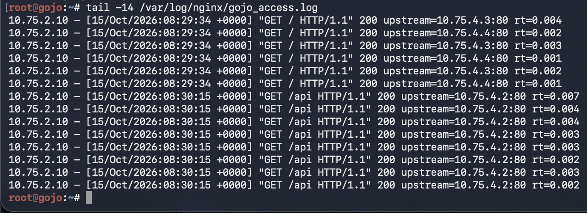         |

### Kesimpulan

Akses web utama dari klien dibalas bergantian oleh maki dan panda, sedangkan akses
`/api` diteruskan melalui geto dan dijawab oleh nanami atau todo.

## Soal 17 — IP Asli Klien (X-Real-IP & X-Forwarded-For)

### Deskripsi

gojo dan geto meneruskan alamat klien melalui `X-Real-IP` dan `X-Forwarded-For`.
geto hanya mempercayai header dari proxy terpercaya (gojo), dan API menyimpan IP
klien yang telah diverifikasi ke kolom `client_ip`.

### Konfigurasi

**gojo**: sudah meneruskan kedua header sejak soal 16 di location `/` dan `/api`:

```
proxy_set_header X-Real-IP $remote_addr;
proxy_set_header X-Forwarded-For $proxy_add_x_forwarded_for;
```

**geto** — [soal-17/script/geto/geto-soal17.sh](soal-17/script/geto/geto-soal17.sh),
file `/etc/nginx/conf.d/geto-realip.conf`:

```
set_real_ip_from 10.75.1.4;
real_ip_header   X-Real-IP;

map $http_x_forwarded_for $geto_xff {
    ""      $realip_remote_addr;
    default "$http_x_forwarded_for, $realip_remote_addr";
}
```

dan pada site `lb-api`:

```
proxy_set_header X-Real-IP $remote_addr;
proxy_set_header X-Forwarded-For $geto_xff;
```

**nanami, todo & kirara** — [soal-17/script/nanami/nanami-soal17.sh](soal-17/script/nanami/nanami-soal17.sh):

```php
$trusted_proxy = '10.75.4.2';
$proxy_ip  = $_SERVER['REMOTE_ADDR'];
$client_ip = $proxy_ip;
$real_ip   = $_SERVER['HTTP_X_REAL_IP'] ?? '';
if ($proxy_ip === $trusted_proxy && filter_var($real_ip, FILTER_VALIDATE_IP)) {
    $client_ip = $real_ip;
}
```

### Penjelasan

1. **Masalah awal**: geto menulis `X-Real-IP $remote_addr`, dan dari sudut pandang
   geto yang datang adalah gojo, sehingga `client_ip` tercatat 10.75.1.4.
2. **Modul realip** (`set_real_ip_from` + `real_ip_header`): jika request datang dari
   gojo, geto mengganti `$remote_addr` dengan isi `X-Real-IP` (IP klien asli). Jika
   datang dari node lain, header tersebut diabaikan.
3. **`X-Forwarded-For`** adalah jejak proxy yang dilewati. geto menambahkan IP gojo
   (`$realip_remote_addr`) sehingga hasilnya `IP-klien, 10.75.1.4`.
4. **Verifikasi kedua di worker**: `X-Real-IP` hanya dipakai jika pengirimnya geto
   dan isinya IP valid. Query memakai _prepared statement_ agar isi header tidak
   dapat merusak query.
5. **Realip tidak dipasang di worker**, karena `allow 10.75.4.2` di worker akan
   memeriksa IP klien hasil realip dan menolak request.

### Pengujian

| Pengujian                                               | Bukti                                                   |
| ------------------------------------------------------- | ------------------------------------------------------- |
| Konfigurasi gojo                                        | 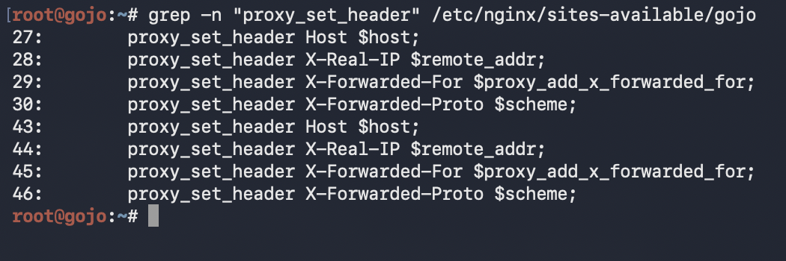          |
| Konfigurasi geto                                        | 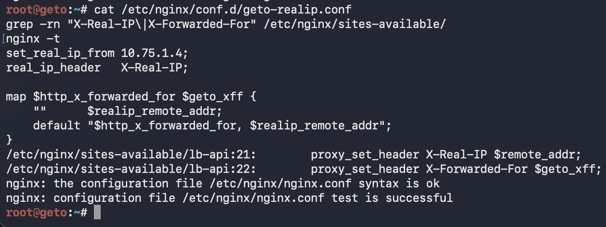          |
| Skrip API                                               | 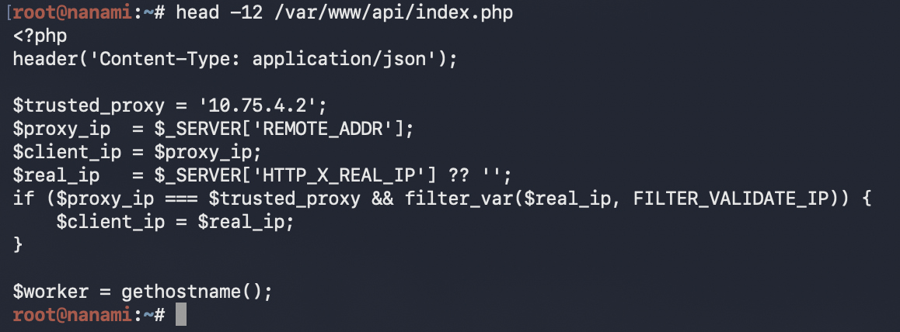            |
| Klien Network 2 (itadori)                               | 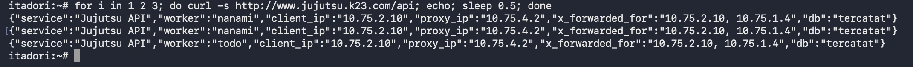           |
| Klien Network 3 (kugisaki)                              | 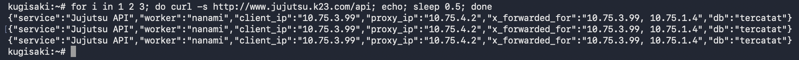           |
| Header palsu lewat gojo                                 | 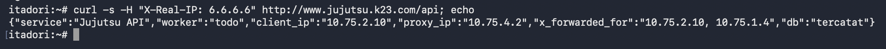 |
| Header palsu langsung ke geto dari maki                 | 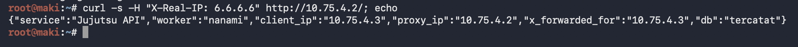 |
| Isi `request_logs` di yaga                              | 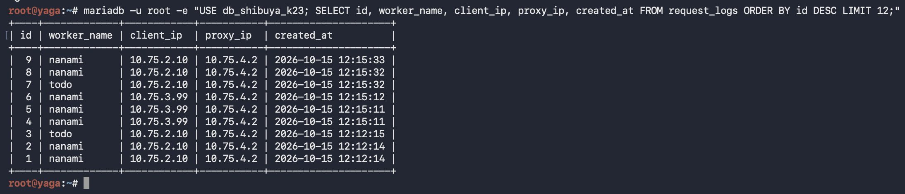               |

```
itadori : "client_ip":"10.75.2.10","proxy_ip":"10.75.4.2","x_forwarded_for":"10.75.2.10, 10.75.1.4"
kugisaki: "client_ip":"10.75.3.99","proxy_ip":"10.75.4.2","x_forwarded_for":"10.75.3.99, 10.75.1.4"

X-Real-IP: 6.6.6.6 dari itadori lewat gojo -> "client_ip":"10.75.2.10"
X-Real-IP: 6.6.6.6 dari maki langsung geto -> "client_ip":"10.75.4.3"
```

Isi `request_logs` di yaga setelah request dari itadori dan kugisaki:

```
| id | worker_name | client_ip  | proxy_ip  | created_at          |
|  9 | nanami      | 10.75.2.10 | 10.75.4.2 | 2026-10-15 12:15:33 |
|  8 | nanami      | 10.75.2.10 | 10.75.4.2 | 2026-10-15 12:15:32 |
|  7 | todo        | 10.75.2.10 | 10.75.4.2 | 2026-10-15 12:15:32 |
|  6 | nanami      | 10.75.3.99 | 10.75.4.2 | 2026-10-15 12:15:12 |
|  5 | nanami      | 10.75.3.99 | 10.75.4.2 | 2026-10-15 12:15:11 |
|  4 | nanami      | 10.75.3.99 | 10.75.4.2 | 2026-10-15 12:15:11 |
|  3 | todo        | 10.75.2.10 | 10.75.4.2 | 2026-10-15 12:12:15 |
|  2 | nanami      | 10.75.2.10 | 10.75.4.2 | 2026-10-15 12:12:14 |
|  1 | nanami      | 10.75.2.10 | 10.75.4.2 | 2026-10-15 12:12:14 |
```

### Kesimpulan

IP yang tercatat adalah IP klien asal (10.75.2.10 untuk Network 2, 10.75.3.99 untuk
Network 3), bukan IP gojo maupun geto. Header palsu tidak dapat mengubah IP yang
tercatat: lewat gojo header ditimpa dengan IP asli, sedangkan langsung ke geto
header diabaikan karena pengirimnya bukan proxy terpercaya.

## Soal 18 — Backup Server dan Passive Health Check

### Deskripsi

kirara menjadi server `backup` pada `api_cluster`, dengan `max_fails=2` dan
`fail_timeout=5s` pada nanami dan todo. Saat nanami dan todo dihentikan, request
`/api` dialihkan ke kirara tanpa 502.

### Konfigurasi

[soal-18/script/geto/geto-soal18.sh](soal-18/script/geto/geto-soal18.sh)

```
upstream api_cluster {
    zone api_cluster 64k;
    server 10.75.4.5 weight=3 max_fails=2 fail_timeout=5s;   # nanami
    server 10.75.4.6 weight=1 max_fails=2 fail_timeout=5s;   # todo
    server 10.75.4.7 backup;                                 # kirara
}
```

### Penjelasan

1. **Passive health check**: Nginx tidak mengirim ping khusus, tetapi menilai dari
   request sungguhan. Jika gagal 2 kali (`max_fails=2`) dalam 5 detik, server
   dianggap mati selama 5 detik (`fail_timeout=5s`) lalu dicoba lagi.
2. **`backup`**: kirara hanya menerima request ketika semua server utama dianggap
   mati.
3. **Request yang gagal tidak menjadi 502**: Nginx otomatis mencoba server berikutnya
   (`proxy_next_upstream` bawaan untuk error koneksi), sehingga klien tetap
   mendapat jawaban dari kirara.
4. **kirara memakai skrip API yang sama** dengan nanami dan todo, sehingga
   endpoint dan format responsnya kompatibel.

### Pengujian

| Pengujian                               | Bukti                                             |
| --------------------------------------- | ------------------------------------------------- |
| Konfigurasi geto                        | 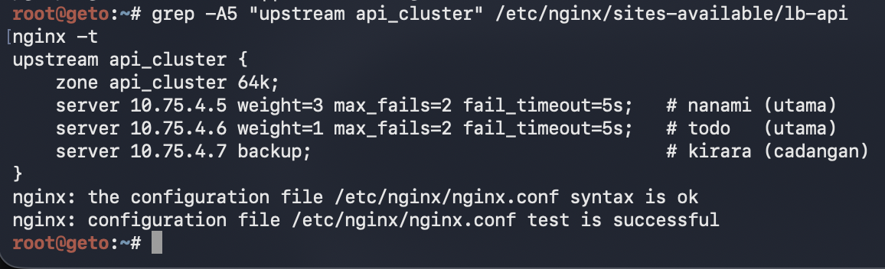       |
| Kondisi normal (nanami / todo)          | 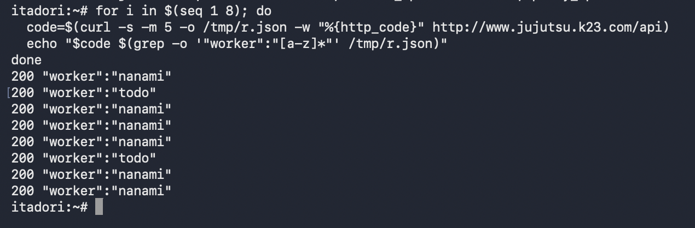       |
| nginx nanami dihentikan                 | 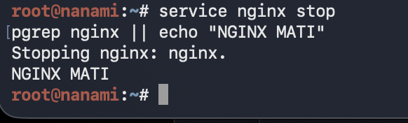 |
| nginx todo dihentikan                   | 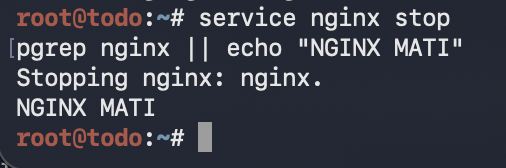 |
| Request dari klien dijawab kirara       |  |
| nanami dan todo dinyalakan kembali      | 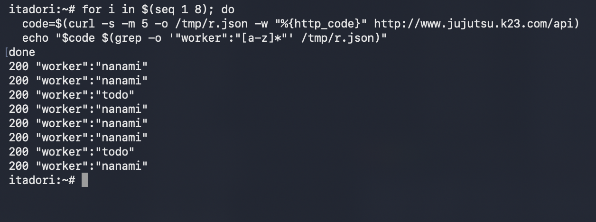         |
| Access log geto                         | 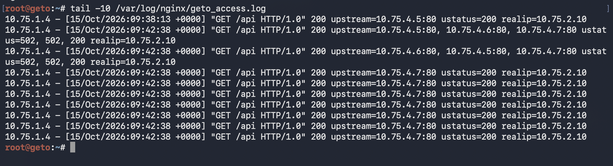        |

### Kesimpulan

Saat nanami dan todo mati, request `/api` dari klien dijawab oleh kirara dengan JSON
yang valid tanpa 502. Setelah keduanya dinyalakan kembali, trafik kembali ke
nanami dan todo.

## Soal 19 — Proxy Cache dan Rate Limiting di gojo

### Deskripsi

Cache 10 menit untuk halaman web frontend dengan header `X-Cache-Status`, serta
rate limit 10 request/detik per IP klien pada `/api`.

### Konfigurasi

[soal-19/script/gojo/gojo-soal19.sh](soal-19/script/gojo/gojo-soal19.sh)

```
proxy_cache_path /var/cache/nginx/web levels=1:2 keys_zone=web_cache:10m
                 max_size=100m inactive=10m use_temp_path=off;
limit_req_zone $binary_remote_addr zone=api_limit:10m rate=10r/s;

location / {
    ...
    proxy_cache web_cache;
    proxy_cache_valid 200 10m;
    add_header X-Cache-Status $upstream_cache_status always;
}

location /api {
    limit_req zone=api_limit;
    limit_req_status 429;
    ...
}
```

### Penjelasan

1. **`proxy_cache_valid 200 10m`**: halaman dengan status 200 disimpan selama 10
   menit. Akses pertama **MISS** (diambil dari maki/panda lalu disimpan), akses
   berikutnya **HIT** (dijawab langsung dari simpanan gojo).
2. **`$binary_remote_addr`**: batas dihitung per IP klien, dalam bentuk biner agar
   hemat memori.
3. **`rate=10r/s` tanpa `burst`**: Nginx mengizinkan 1 request setiap 100 ms.
   Request yang datang lebih cepat langsung ditolak.
4. **`limit_req_status 429`**: status penolakan diubah dari bawaan 503 menjadi
   **429 Too Many Requests**, yang memang berarti "terlalu banyak request".
5. **Cache hanya di `/`**, karena API harus selalu menjawab data terbaru dan mencatat
   setiap request ke database.

### Pengujian

| Pengujian                               | Bukti                                              |
| --------------------------------------- | -------------------------------------------------- |
| Konfigurasi gojo                        |         |
| MISS lalu HIT                           |           |
| 30 request bersamaan ke `/api`          |       |
| Access log gojo                         |          |
| Request berjeda 0,5 detik               |     |

```
== Akses ke-1 ==   X-Cache-Status: MISS   Dilayani oleh: maki
== Akses ke-2 ==   X-Cache-Status: HIT    Dilayani oleh: maki
== Akses ke-3 ==   X-Cache-Status: HIT    Dilayani oleh: maki

30 request bersamaan ke /api:
      1 200
     29 429

Access log gojo:
10.75.2.10 - [15/Oct/2026:09:58:17 +0000] "GET /api HTTP/1.1" 429 upstream=- cache=- rt=0.000
10.75.2.10 - [15/Oct/2026:09:58:17 +0000] "GET /api HTTP/1.1" 200 upstream=10.75.4.2:80 cache=- rt=0.019
```

### Kesimpulan

Akses pertama ke halaman web berstatus MISS dan akses berikutnya HIT. Akses
ke-2 dan ke-3 tetap menampilkan "maki" karena dijawab dari cache, bukan dari
worker. Dari 30 request bersamaan ke `/api`, hanya 1 yang lolos dan 29 ditolak
dengan **429**. Log gojo mencatat `upstream=-` pada request yang ditolak, artinya
request tersebut berhenti di gojo dan tidak membebani geto. Request berjeda 0,5
detik (2 request/detik) seluruhnya 200 karena masih di bawah batas.

## Soal 20 — Benchmark dan Analisis Rate Limiting

### Deskripsi

Dari kusakabe, menjalankan Apache Benchmark `-n 600 -c 30` ke
`http://jujutsu.k23.com/` (baseline) dan ke `/api` (rate limiting aktif), mencatat
RPS, latensi, dan jumlah request gagal, lalu memakai access log gojo untuk
membedakan kegagalan aplikasi, kegagalan koneksi, dan request yang ditolak
rate limit.

### Konfigurasi

- **kusakabe** — [soal-20/script/kusakabe/kusakabe-soal20.sh](soal-20/script/kusakabe/kusakabe-soal20.sh):
  memasang `apache2-utils` lalu menjalankan kedua benchmark dan menyimpan hasilnya
  ke `/root/soal20-ab-root.txt` dan `/root/soal20-ab-api.txt`.
- **gojo** — [soal-20/script/gojo/gojo-soal20.sh](soal-20/script/gojo/gojo-soal20.sh):
  merangkum `gojo_access.log` per path, status, dan tujuan, serta menghitung pesan
  di `error.log`.

Sebelum benchmark, kedua log gojo dikosongkan agar hanya berisi request pengujian:

```bash
: > /var/log/nginx/gojo_access.log
: > /var/log/nginx/error.log
```

Kriteria pembeda di log gojo (format `... "$request" $status upstream=$upstream_addr cache=$upstream_cache_status ...`):

| Jenis                         | Ciri                                                          |
| ----------------------------- | ------------------------------------------------------------- |
| Ditolak rate limit            | status `429`, `upstream=-`, `error.log`: `limiting requests`  |
| Kegagalan aplikasi            | status `5xx` dengan `upstream=<IP>`                           |
| Kegagalan koneksi             | status `499`, atau `error.log`: `connect() failed` / `upstream timed out` |

### Pengujian

| Pengujian                  | Bukti                                         |
| -------------------------- | --------------------------------------------- |
| Benchmark `/` (baseline)   |     |
| Benchmark `/api`           |       |
| Analisis log gojo          |     |

Hasil Apache Benchmark:

| Metrik                         | `/` (baseline) | `/api` (rate limit aktif) |
| ------------------------------ | -------------- | ------------------------- |
| Complete requests              | 600            | 600                       |
| Respons 200                    | 600            | 1                         |
| Non-2xx responses              | 0              | 599                       |
| Failed requests                | 0              | 599 (Connect 0, Receive 0, **Length 599**, Exceptions 0) |
| Requests per second            | **8144,43**    | 6388,08                   |
| Time per request (mean)        | 3,684 ms       | 4,696 ms                  |
| Time per request (all conc.)   | 0,123 ms       | 0,157 ms                  |
| Persentil 50% / 90% / 99%      | 3 / 4 / 7 ms   | 4 / 5 / 6 ms              |
| Request terlama                | 7 ms           | 11 ms                     |

Analisis log gojo:

```
== Status per path ==
    600 / 200 dijawab-gojo(cache)
      1 /api 200 diteruskan-ke-upstream
    599 /api 429 ditolak-rate-limit
== Cache untuk / ==
    600 cache=HIT
== Kategori ==
berhasil (2xx/3xx)          = 601
ditolak rate limit (429)    = 599
gagal aplikasi (5xx)        = 0
koneksi diputus klien (499) = 0
== error.log ==
limiting requests        : 599
gagal koneksi ke upstream: 0
```

### Analisis

1. **Baseline `/`**: seluruh 600 request berhasil dengan 8144 RPS dan latensi
   rata-rata 3,7 ms. Log menunjukkan ke-600 request berstatus `cache=HIT`, artinya
   dijawab langsung dari cache gojo (soal 19) tanpa diteruskan ke maki/panda.
   Akses `MISS` sudah terjadi sebelum log dikosongkan (saat pengecekan awal),
   sehingga selama benchmark halaman selalu tersedia di cache.
2. **`/api`**: hanya 1 request yang lolos. Batas 10 request/detik tanpa `burst`
   berarti 1 request per 100 ms, sedangkan 600 request selesai dikirim dalam
   ±0,094 detik (600 ÷ 6388). Sisanya (599) ditolak dengan **429**.
3. **"Failed requests: 599" bukan kegagalan koneksi.** `ab` menghitung request
   sebagai gagal jika panjang jawabannya berbeda dari jawaban pertama. Jawaban
   pertama adalah JSON 200, sedangkan 599 lainnya halaman 429, sehingga tercatat
   sebagai `Length`. Nilai `Connect`, `Receive`, dan `Exceptions` semuanya 0.
4. **Pembedaan dari log gojo:**
   - **Ditolak rate limit: 599**, seluruhnya status 429 tanpa upstream, dan
     `error.log` mencatat 599 pesan `limiting requests`.
   - **Kegagalan aplikasi: 0**, tidak ada status 5xx.
   - **Kegagalan koneksi: 0**, tidak ada status 499 maupun `connect() failed` /
     `upstream timed out`.
5. **RPS `/api` tetap tinggi (6388)** karena request yang ditolak dijawab langsung
   oleh gojo tanpa menyentuh geto, worker, maupun database. Rate limit melindungi
   backend: dari 600 request, hanya 1 yang benar-benar sampai ke backend.

### Kesimpulan

Baseline `/` melayani 600 request tanpa kegagalan (8144 RPS, rata-rata 3,7 ms)
berkat cache gojo. Pada `/api`, rate limiting menolak 599 dari 600 request dengan
status 429. Access log dan error log gojo memastikan seluruh "kegagalan" pada
`/api` adalah penolakan kebijakan rate limit, bukan kegagalan aplikasi maupun
koneksi.
